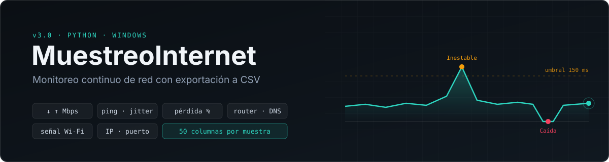

<p align="center"></p>

<p align="center">
  
  
  
  
  
  
  
  
  
</p>

---

## 📋 Descripción General

**MuestreoInternet** es un sistema automatizado de telemetría de red desarrollado en **Python**, estructurado bajo principios de **Clean Code** y **arquitectura modular por capas**. Su propósito es capturar métricas exhaustivas de rendimiento de red a intervalos regulares (**cada 10 segundos**), validando y persistiendo los registros mediante modelos tipados en un dataset con formato **CSV (`UTF-8`)**.

Está optimizado para la generación de datasets destinados a análisis exploratorio de datos (EDA), auditorías de estabilidad de proveedores de internet (ISP) o procesamiento analítico en herramientas como Pandas, Excel y Power BI.

---

## 📋 Descripción General

**MuestreoInternet** es un sistema automatizado de telemetría de red desarrollado en **Python**, estructurado bajo principios de **Clean Code** y **arquitectura modular por capas**. Su propósito es capturar métricas exhaustivas de rendimiento de red a intervalos regulares (**cada 10 segundos**), validando y persistiendo los registros mediante modelos tipados en un dataset con formato **CSV (`UTF-8`)**.

Está optimizado para la generación de datasets destinados a análisis exploratorio de datos (EDA), auditorías de estabilidad de proveedores de internet (ISP) o procesamiento analítico en herramientas como Pandas, Excel y Power BI.

---

## 🏛️ Arquitectura del Proyecto (Clean Code)

El código fuente está encapsulado dentro del paquete `src/` y desacoplado en capas con responsabilidad única, tipado estático (*Type Hints*) y docstrings documentados:

```text
muestreo_internet/
├── docs/
│   └── banner.svg                 # Banner vectorial gráfico de cabecera
├── salidas/
│   └── resultado.csv              # Dataset consolidado de telemetría (Generado automáticamente)
├── src/                           # Paquete principal del núcleo de la aplicación
│   ├── __init__.py                # Inicializador del paquete Python
│   ├── config.py                  # [Capa de Configuración] Rutas, intervalos, umbrales y cabeceras
│   ├── models.py                  # [Capa de Dominio] Dataclass tipado MuestraRed
│   ├── network_service.py         # [Capa de Red] Interacción con netsh (Wi-Fi) y speedtest
│   ├── storage_service.py         # [Capa de Persistencia] Gestión de directorios e I/O en CSV
│   └── monitor.py                 # [Capa de Negocio] Orquestador de muestreo y diagnóstico
├── main.py                        # [Punto de Entrada] Arranque minimalista de la aplicación
├── ejecutar.bat                   # Lanzador interactivo automatizado para Windows
├── requirements.txt               # Dependencias externas del entorno Python
├── .gitignore                     # Exclusiones de control de versiones Git
├── .gitattributes                 # Normalización multiplataforma de saltos de línea (LF/CRLF)
└── README.md                      # Documentación técnica oficial


📊 Estructura del Dataset (17 Variables Analíticas)Cada muestra capturada inserta una fila estructurada en el archivo salidas/resultado.csv conteniendo las siguientes columnas:

| # | Columna | Tipo | Descripción |
|---|---|---|---|
| 1 | `id_muestra` | Entero | ID secuencial autoincremental para conteo, indexación y lectura rápida. |
| 2 | `timestamp` | Texto | Fecha y hora exacta de la toma de muestra (YYYY-MM-DD HH:MM:SS). |
| 3 | `modo_monitoreo` | Texto | Modo activo de ejecución (Automático o Manual). |
| 4 | `proveedor_servicio` | Texto | Proveedor de Internet (ISP) detectado por la infraestructura de prueba. |
| 5 | `ssid_objetivo` | Texto | Red de referencia configurada por el usuario (en modo manual). |
| 6 | `ssid_actual` | Texto | Nombre real de la red Wi-Fi conectada en el momento del registro. |
| 7 | `calidad_senal_porcentaje` | Entero | Intensidad de la señal Wi-Fi de red detectada (0% a 100%). |
| 8 | `tipo_conexion` | Texto | Tipo de medio físico (Wi-Fi o Ethernet / Cable). |
| 9 | `velocidad_bajada_mbps` | Numérico | Capacidad de descarga de datos hacia el dispositivo (Mbps). |
| 10 | `velocidad_subida_mbps` | Numérico | Capacidad de envío de datos desde el dispositivo (Mbps). |
| 11 | `velocidad_promedio_mbps` | Numérico | Promedio matemático entre la bajada y subida de la muestra. |
| 12 | `ping_ms` | Numérico | Latencia o tiempo de respuesta de la conexión (milisegundos). |
| 13 | `jitter_ms` | Numérico | Variación estimada en la latencia de red (milisegundos). |
| 14 | `perdida_paquetes_pct` | Numérico | Porcentaje de paquetes perdidos durante el sondeo. |
| 15 | `tiempo_registro_s` | Numérico | Segundos exactos que tardó la ejecución completa del ciclo de prueba. |
| 16 | `estado_conexion` | Texto | Evaluación heurística (Estable, Inestable o Caída detectada). |
| 17 | `observaciones` | Texto | Notas automáticas del comportamiento del ciclo o incidencias. |

## 🚀 Guía de Instalación y Ejecución

### Requisitos Previos
* **Python** (versión 3.10 o superior) instalado y añadido a las variables de entorno (`PATH`) de Windows.
* Tarjeta de red Wi-Fi o conexión por cable activa.

### Modo de Uso Rápido (Recomendado)
1. Da doble clic en el archivo **`ejecutar.bat`**.
2. El script comprobará la disponibilidad de Python, instalará las dependencias necesarias de manera silenciosa y creará la estructura de directorios (`salidas/`) junto con el archivo CSV si no existen.
3. Selecciona el modo de operación en la consola interactiva:
   - **`[1] Modo Automático:`** Captura y registra dinámicamente la red activa en el dispositivo.
   - **`[2] Modo Manual:`** Permite ingresar o fijar el nombre de una red objetivo específica para el etiquetado.
4. El sistema comenzará a tomar muestras de manera periódica cada **10 segundos**.

### Detención Segura
Para finalizar el monitoreo en cualquier momento y asegurar que el dataset quede correctamente guardado e intacto, presiona **`Ctrl + C`** en la ventana de la terminal.